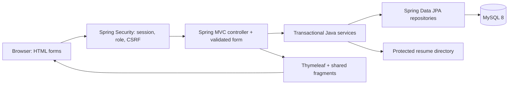
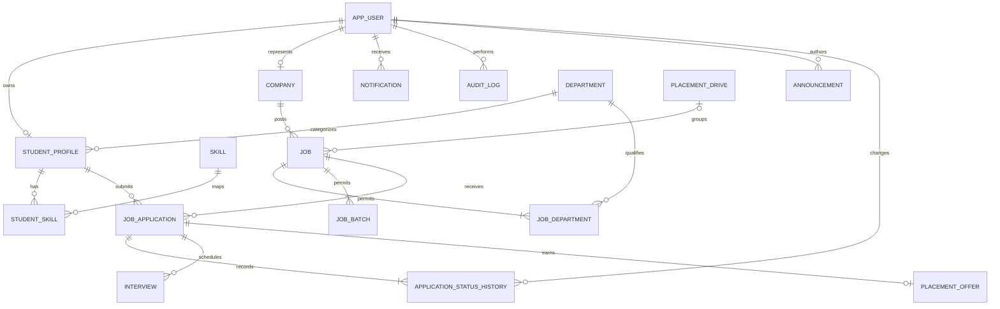
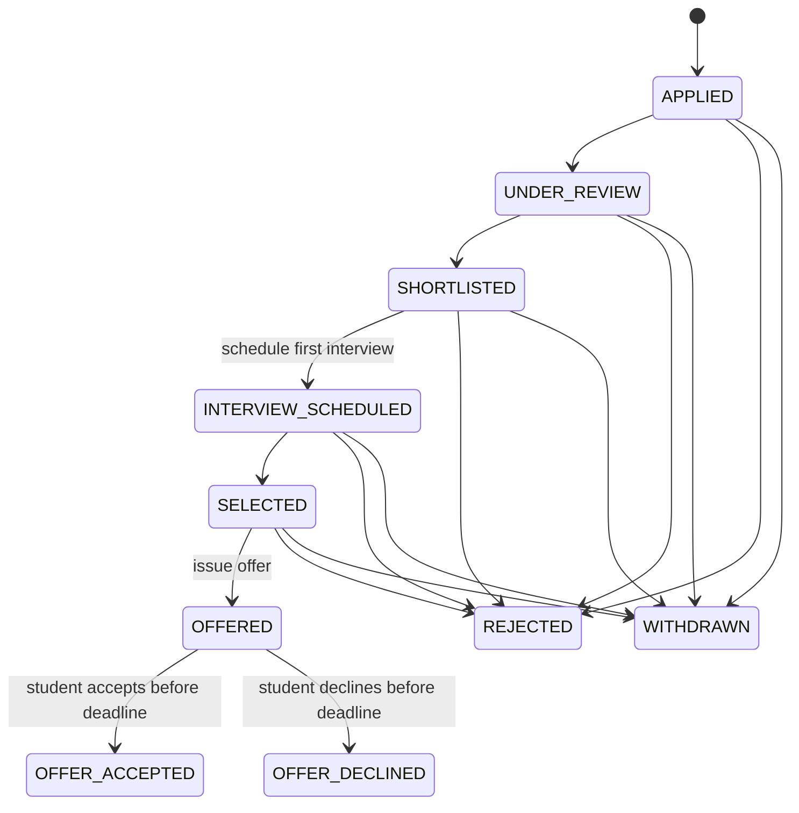

# Architecture and database guide

## Request lifecycle

Controllers map URLs, validate forms and prepare views. Services enforce business rules and sensitive object ownership. Repositories persist entities; foreign keys, uniqueness and optimistic versions back up application checks. Multi-record transitions update the current application, history, notifications and audit log in the same database transaction.

## Packages

| Package | Responsibility |
|---|---|
| config | Security filter chain, BCrypt, UTC clock, development seeding, explicit administrator bootstrap |
| controller | Public/account/job/recruitment/staff MVC routes and safe exception advice |
| service | Accounts, job management, eligibility, recruitment workflow, offers/interviews, access checks, reports, resume storage, audit/notifications |
| entity | JPA persistence model and shared ID/timestamps/version |
| repository | Spring Data JPA queries and specifications |
| form | Dedicated Jakarta-validated input models; entities are not bound to web requests |
| dto | Table-row display projection |
| enums | Roles, states and employment type |
| exception | Business validation errors |
| util | CSV escaping and formula neutralization |
| templates | Public pages, authenticated screens, forms, shared layout fragments |
| static | Local CSS and minimal navigation/confirmation/export JavaScript |

## Entity relationships

Every entity inherits `id` (generated BIGINT), `created_at`, `updated_at` and `version`. The version enables optimistic locking, preventing concurrent status or offer responses from silently overwriting each other.

| Table / mapping | Significant fields and constraints |
|---|---|
| app_user | Unique normalized email, BCrypt password, full name, role enum, enabled flag |
| student_profile | Unique non-null user FK, unique registration number, department, degree, batch, decimal CGPA, backlogs, phone, education history, projects, certifications, achievements, resume key |
| department | Unique code, display name; maintained by administrators |
| company | Unique non-null user FK, name, description, website, location, approval enum |
| placement_drive | Name, academic year, batch, start/end date, venue |
| job | Company FK, optional drive FK, role description, skills, employment type, location, DECIMAL(14,2) salary range, CGPA/backlog requirements, opening/deadline instants, vacancies, status |
| job_department | Join table linking database-managed departments to eligible jobs |
| job_batch | Element-collection relationship with one graduating batch per row |
| skill / student_skill | Reusable unique skill names and student-skill join table |
| job_application | Student FK + job FK unique pair, current status enum, creation timestamp |
| application_status_history | Application and actor FKs, old/new status, note, transition timestamp |
| interview | Application FK, round, type, date/time, location, student-visible instructions, scheduled/completed/cancelled status |
| placement_offer | Unique application FK, decimal salary, issue/deadline/response instants, pending/accepted/declined status |
| announcement | Author FK, title/body, publication instant |
| notification | Recipient FK, message, read flag, creation instant |
| audit_log | Actor FK, action, target ID, creation instant |

Indexes cover job publication/deadline/company, application status/job, student department/batch, notification recipient/read state, and unique identity fields. Hibernate applies physical snake_case naming. Do not treat comma-separated **input** for skills as storage: the service normalizes it into individual `skill` rows and a join table. Job eligibility uses collection tables, not delimited strings. Narrative education/project sections are free text by design.

Deletion is deliberately conservative. No cascade REMOVE is used across recruitment data. Only a draft job with no applications can be deleted. Other jobs are closed or cancelled; student accounts are disabled rather than deleting audit/recruitment history. Announcements can be deleted by placement staff. Students cannot replace account identity fields through profile forms.

## Access policy

| Capability | Student | Recruiter | Coordinator | Admin |
|---|---|---|---|---|
| Profile | Own student profile | Own company profile | — | View/edit students |
| Active opportunities | Browse/apply if eligible | Own jobs | All jobs | All jobs |
| Applications / resumes | Own | Applicants to owned jobs only | All applicants | All applicants |
| Recruitment status / interview / issue offer | — | Owned jobs only | Yes | Yes |
| Offer response | Own pending valid offer | — | — | — |
| Company approval / disable student | — | — | — | Yes |
| Drives / announcements / reports | Read announcements | Read announcements | Manage | Manage |
| Audit history | — | — | — | Yes |
| Notifications / password | Own | Own | Own | Own |

Routes under `/admin`, `/staff`, `/student` and `/company` have URL role checks. Shared `/manage` and recruitment routes also perform service/controller object authorization because a role check alone cannot determine company ownership. Resume access is based on ownership, staff status, or a real application to the requesting recruiter's company.

## Application state machine

Interview and offer states cannot be selected as generic dropdown transitions: the corresponding scheduling/offer services create the required records first. Students cannot select themselves or issue offers. Accepted/declined/rejected/withdrawn outcomes are terminal. A withdrawn application continues to occupy the unique student/job pair; resubmission is not permitted.

Applications open inclusively at `opensAt` and close exclusively at `deadline`. Eligibility checks the job and company state, current time, CGPA, department, graduating batch, active backlogs and existing application. The same service runs on submission, so changing HTML cannot bypass eligibility. The database unique pair remains the final defense against simultaneous submissions.

## Reporting and scale

Dashboard values come from database records. Accepted students are deduplicated by student ID. Report filtering and percentage definitions are documented in the README and displayed in the UI. Job discovery uses database specifications, paging and an allowlisted sort. Smaller management tables use Java filtering and paging over repository results; this is suitable for the college demo dataset. For a very large deployment, replace those reads and report aggregates with paginated DTO/projection queries.

## Security and operational boundaries

- BCrypt passwords, normalized email login, no public admin registration.
- CSRF enabled, POST mutation routes, auto-injected tokens in Thymeleaf forms.
- Session fixation protection; HttpOnly / SameSite cookies, optional secure cookies for HTTPS.
- Escaped Thymeleaf output, validated forms, no raw HTML rendering of user text.
- Explicit file-content checks, bounded DOCX ZIP scanning, generated names, protected attachments and directory containment.
- Safe public error pages and suppressed stack traces; server logs retain diagnostics.
- Optimistic locking and database constraints preserve write consistency.
- Application timestamps use `Instant`/UTC; form conversion uses the configured APP_TIME_ZONE.

The scope is a single-college, single-instance demonstration. It does not implement email delivery, password recovery, institutional SSO, malware scanning, email verification, offer-document generation, or multi-campus tenancy. These are future extensions, not simulated features.
